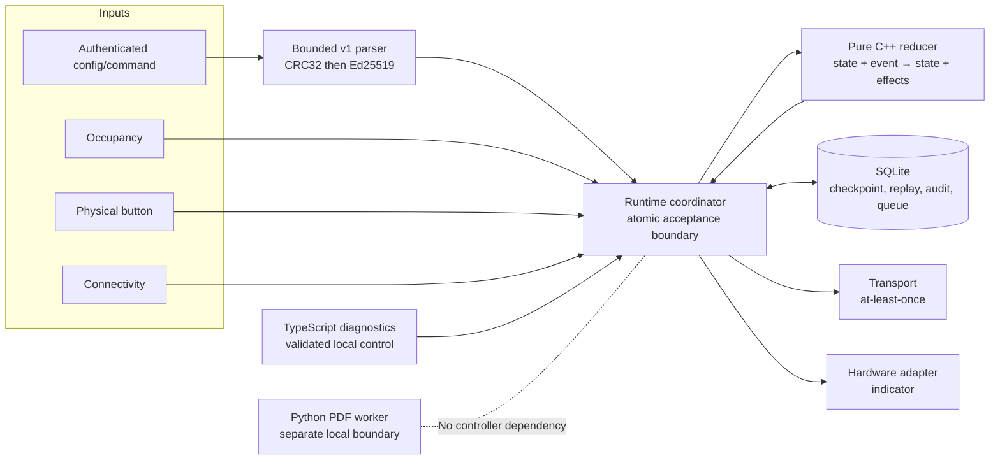

# Architecture overview

SourceTrace Edge Lab separates deterministic policy from effectful adapters.
Inputs carry explicit monotonic event time. The pure reducer returns the next
state and requested effects; only the runtime may execute and atomically commit
them.

## Controller layers

The core defines explicit mode, health, configuration, event, effect, audit,
and HAL contracts. It cannot read wall-clock time or perform I/O. The simulator
orders same-time events deterministically and supports seeded sensor noise.

The protocol layer owns a 4-byte length prefix, fixed 44-byte header, at most
4096 payload bytes, optional 64-byte Ed25519 signature, and final CRC32. Its
fixed 4212-byte buffer prevents a length field from driving allocation.

The runtime translates authenticated configuration/commands to domain events.
It commits state, replay record, audit events, outbound frames, and sequence
metadata together. An I/O failure leaves the prior durable state intact and
surfaces a storage-fault indication.

SQLite is a single-process, one-writer durable adapter. It is not a distributed
database. The transport simulator provides deterministic send, acknowledgement,
and fault behavior; it is not a network security implementation.

## Supporting boundaries

The TypeScript application controls a local child process with exact Zod
contracts and displays independently decoded binary frames. It never decides
controller policy.

The Python service is intentionally independent of the controller. It
demonstrates streamed input bounds, isolated document tooling, cleanup,
idempotency, failure classification, and metadata-only retention.

## Data and failure flow

1. Validate input before application interpretation.
2. Reduce an explicit event to candidate state and effects.
3. Pre-encode and capacity-check outbound records.
4. Commit the complete acceptance batch with `BEGIN IMMEDIATE`.
5. Apply non-durable hardware output and attempt transport delivery.
6. Persist acknowledgement deletion or retry metadata.
7. On restart, reconstruct checkpoint, replay high-water mark, queue, and
   retries before accepting more work.

This sequence establishes deterministic application behavior and a clear local
atomicity boundary. It does not establish Byzantine fault tolerance, remote
attestation, exactly-once transport, or physical durability guarantees.
